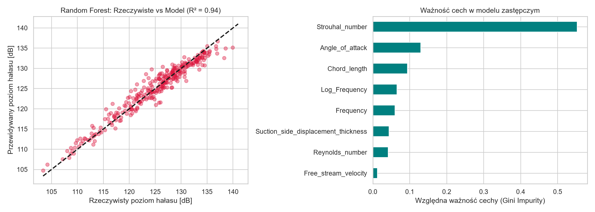
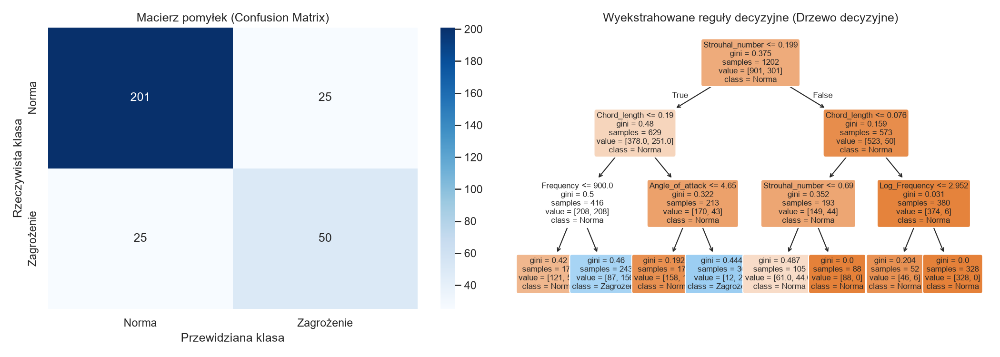

# Airfoil Self-Noise Surrogate Modeling

System predykcji emisji ciśnienia akustycznego profilu lotniczego (NACA 0012) na bazie danych eksperymentalnych NASA, stanowiący nieliniowy model zastępczy (Surrogate Model) dla numerycznych symulacji wibroakustycznych (BEM/CFD).

Aplikacja wykorzystuje metody inteligencji obliczeniowej oraz inżynierię cech opartą na bezwymiarowych liczbach podobieństwa mechaniki płynów (liczba Strouhala, liczba Reynoldsa) do natychmiastowej estymacji hałasu aerodynamicznego oraz ekstrakcji fizycznych reguł decyzyjnych definiujących stany przekroczenia norm akustycznych.

## Architektura projektu

```text
airfoil-self-noise-surrogate-model/
│
├── .github/
│   └── workflows/             # automatyczny pipeline CI
│
├── notebooks/
│   └── airfoil_analysis.ipynb # środowisko analityczne end-to-end (ETL, EDA, modele)
│
├── reports/
│   └── figures/               # wyeksportowane wizualizacje analityczne o wysokiej rozdzielczości
│       ├── correlation_matrix.png
│       ├── distribution_and_strouhal.png
│       ├── pivot_angle_velocity.png
│       ├── regression_performance.png
│       └── classification_tree.png
│
├── requirements.txt           # specyfikacja zależności środowiska Python
└── README.md
```

## Założenia projektowe i model inżynierski

### 1. Kontekst aeroakustyczny i ograniczenia numeryczne
Numeryczne rozwiązywanie problemów radiacji akustycznej i opływu profili aerodynamicznych za pomocą Metody Elementów Brzegowych (BEM – równanie falowe Helmholtza) lub symulacji CFD (równania Ffowcs Williamsa-Hawkingsa) wiąże się ze znacznym narzutem czasowym (złożoność rzędu $O(N^2) - O(N^3)$ dla macierzy gęstych). 

Projekt zastępuje kosztowny solver numeryczny modelem uczenia maszynowego aproksymującym skorelowane pole ciśnienia akustycznego (Scaled Sound Pressure Level – SSPL [dB]) w oparciu o geometrię i warunki napływu strugi.

### 2. Inżynieria cech (Physics-Informed Feature Engineering)
Surowy zbiór pomiarowy wzbogacono o bezwymiarowe parametry kryterialne hydrodynamiki i aeroakustyki:

- **Liczba Strouhala ($St$):** kluczowy bezwymiarowy parametr opisujący zjawisko periodycznego odrywania się wirów na krawędzi spływu (wirów von Kármána):
$$St = \frac{f \cdot \delta}{U_\infty}$$
gdzie $f$ oznacza częstotliwość akustyczną [Hz], $\delta$ jest grubością warstwy przyściennej po stronie ssącej [m], a $U_\infty$ prędkością strugi swobodnej [m/s].

- **Liczba Reynoldsa ($Re$):** relacja sił bezwładnościowych do lepkościowych w opływie profilu o cięciwie $c$:
$$Re = \frac{U_\infty \cdot c}{\nu}$$
gdzie przyjęto kinematyczną lepkość powietrza w warunkach normalnych $\nu \approx 1.5 \times 10^{-5} \, \text{m}^2/\text{s}$.

- **Logarytmiczna skala częstotliwości:** uwzględnienie nieliniowej, logarytmicznej natury percepcji ciśnienia akustycznego oraz pasm tercjowych:
$$f_{log} = \log_{10}(f)$$

### 3. Dyskretyzacja domenowa pod analizę grupową i klasyfikację
- **Reżimy kąta natarcia (`Angle_regime`):** podział ciągłego kąta $\alpha$ na przedziały odzwierciedlające stan aerodynamiczny profilu: opływ laminarny/stabilny ($0^\circ - 5^\circ$), stan przejściowy ($5^\circ - 10^\circ$) oraz separację strugi / reżim przeciągnięcia ($> 10^\circ$).
- **Wskaźnik hałasu krytycznego (`High_Noise_Alert`):** sformułowanie problemu klasyfikacji binarnej z progiem decyzyjnym $SSPL \ge 130\text{ dB}$, odpowiadającym normom ochrony przed hałasem wysokoczęstotliwościowym.

## Wyniki modelowania i ewaluacja

### 1. Model zastępczy (Regresja)
Zastosowanie nieliniowego lasu losowego (Random Forest Regressor) pozwoliło na wierne odwzorowanie fizyki zjawiska w porównaniu do bazowej regresji liniowej:

| Model | $R^2$ Score | MAE [dB] | RMSE [dB] |
| :--- | :---: | :---: | :---: |
| Regresja Liniowa | 0.5204 | 3.84 | 4.81 |
| **Random Forest (Surrogate Model)** | **0.9447** | **1.23** | **1.63** |

Analiza istotności cech wykazała dominujący wpływ wyliczonej liczby Strouhala (ponad 55% udziału w redukcji niejednorodności), co potwierdza poprawność fizycznego sformułowania problemu.



### 2. Ekstrakcja reguł inżynierskich (Drzewo decyzyjne)
Płytkie drzewo decyzyjne (`max_depth=3`) posłużyło do wyekstrahowania jawnych reguł determinujących przekroczenie dopuszczalnych progów emisji dźwięku. 

Jako główny węzeł podziału algorytm autonomicznie wyznaczył granicę $St \le 0.199$, co ściśle odpowiada teoretycznej wartości krytycznej dla rezonansu wiro-akustycznego.



## Wymagania i instalacja

Projekt wymaga środowiska Python w wersji 3.10+.

1. Klonowanie repozytorium:
```bash
git clone https://github.com/sztabino/airfoil-self-noise-surrogate-model.git
cd airfoil-self-noise-surrogate-model
```

2. Utworzenie środowiska wirtualnego:
```bash
python -m venv .venv
```

Aktywacja:
- Windows:
```bash
.venv\Scripts\activate
```
- Linux / macOS:
```bash
source .venv/bin/activate
```

3. Instalacja zależności:
```bash
pip install -r requirements.txt
```

## Uruchomienie analizy

Główny potok analityczny (wraz z automatyczną akwizycją danych z repozytorium UCI ML za pośrednictwem API) zawarty jest w pliku notebooka:

```bash
jupyter notebook notebooks/airfoil_analysis.ipynb
```

Alternatywnie plik można otworzyć i wykonać bezpośrednio w środowisku VS Code ze wsparciem rozszerzenia Jupyter.